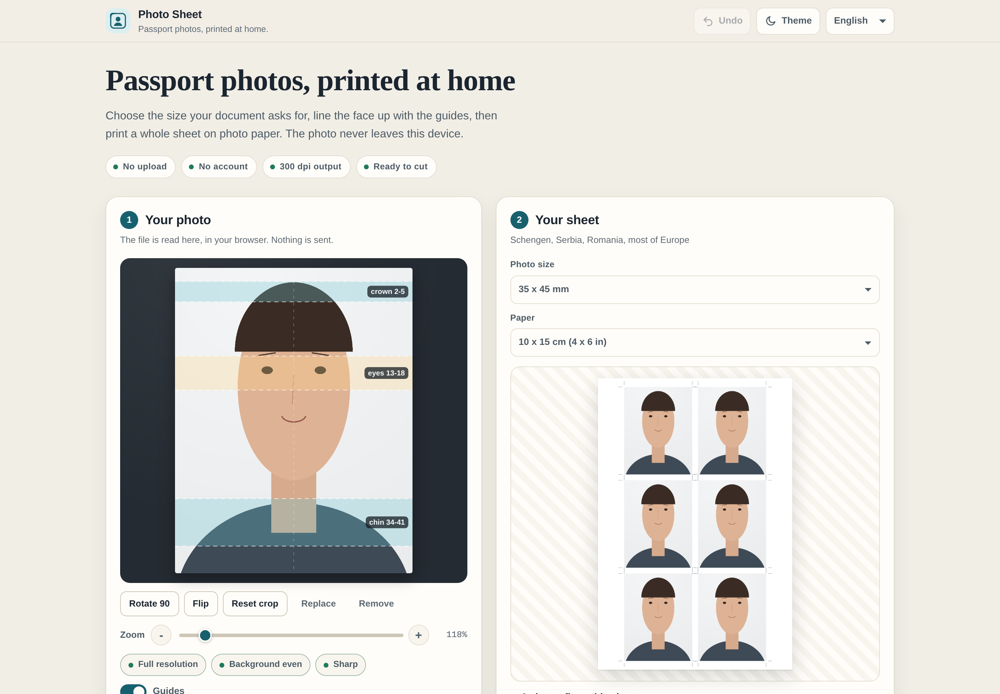

# Photo Sheet

**Passport photos, printed at home.**

[](https://tekideki.github.io/Photo-Sheet/)
[](LICENSE)



Photo Sheet crops one photo to the exact millimetre size a document asks for, then lays it out on a printable sheet with cut marks. It runs entirely in the browser: no server, no account, no analytics, and the photo is never uploaded.

---

## What it does

- **Three document sizes plus a custom one.** 35 x 45 mm for Schengen visas, Serbian passports, Romanian passports and most of Europe; 51 x 51 mm for the United States; 30 x 40 mm for the Romanian identity card. Any other size can be typed in.
- **Millimetre guides.** Three bands on the crop show where the crown, the eyes and the chin should land, drawn from the published rules rather than from taste.
- **Sheets that fit real paper.** 10 x 15 cm, 13 x 18 cm or A4, with a margin, a gap and corner cut marks. Six photos fit a 10 x 15 at 35 x 45 mm, thirty fit an A4.
- **300 dpi output.** The sheet downloads at 1181 x 1772 px for 10 x 15 cm, and the PNG carries a real `pHYs` chunk, so the printer knows the physical size instead of guessing.
- **Print or download.** Print opens the browser dialog on a page sized exactly to the paper; the downloads give a full sheet or a single photo.
- **Honest quality chips.** Resolution, background and sharpness are measured from the actual crop. They report what the pixels support, nothing more.
- **Four languages.** English first, then Romanian, Serbian Latin and Serbian Cyrillic. The chosen language is remembered.

## How to use it

1. Open the page. Choose the size your document asks for.
2. Add a photo. It is read from your disk by the browser; nothing is sent anywhere.
3. Drag, zoom and rotate until the crown, the eyes and the chin sit inside their bands.
4. Check the three chips. A red chip means the crop, not the tool, needs attention.
5. Pick the paper, then **Print** on photo paper at 100 percent, or **Download sheet** and print the file later.
6. Cut on the marks.

## The numbers behind the guides

| Size | Head, chin to crown | Eyes from the bottom | Used for |
|---|---|---|---|
| 35 x 45 mm | 32 to 36 mm | 27 to 32 mm | Schengen visa, Serbian and Romanian passports, most of Europe |
| 51 x 51 mm | 25 to 35 mm | 28 to 35 mm | United States passport and visa |
| 30 x 40 mm | 28 to 32 mm | 24 to 28 mm | Romanian identity card |

These follow published ICAO Doc 9303, EU Visa Code and US State Department ranges. They are guidance, not a guarantee: the authority that issues your document has the last word, and some countries add rules of their own.

## Privacy

- The photo is decoded from a local file into an `Image` object, drawn on a canvas and handed back to you as a download or a print job.
- **No request leaves the page.** The UI test asserts it by recording every request the browser makes.
- A reload forgets the photo, deliberately. Only the size, paper, language and theme are kept, in `localStorage`, under `photo-sheet.v1`.
- No cookies, no analytics, no third party script, no web font, no CDN.
- After the first visit a service worker keeps the shell, so the app opens with no connection.

## What it does not do

- No face detection and no background removal. You place the head against the guides, which is also why the result is predictable and why it works on a phone.
- No retouching. Smoothing, whitened eyes or a replaced background get a photo rejected, so the tool does not offer them.
- No promise of acceptance. It frames and prints; the document office decides.

## Files

| Path | What it is |
|---|---|
| `index.html` | The whole app, built and committed. This is what GitHub Pages serves. |
| `src/template.html` | The shell: header, panels, tips, about, footer |
| `src/styles.css` | All styles, light and dark, plus the print rules |
| `src/photo.js` | The engine: millimetres, presets, sheet layout, crop maths, PNG density |
| `src/app.js` | Interface: file loading, canvas drawing, drag and zoom, exports, print |
| `src/i18n/locales.json` | English, Romanian and Serbian Latin. Serbian Cyrillic is generated. |
| `build.py` | Joins the sources into one file and refuses to build if a rule is broken |
| `sw.js` | Service worker, cache name carries `VERSION` |
| `manifest.json`, `icons/` | Web app manifest and icons, all drawn by `tools/make_icons.py` |
| `tests/logic_test.cjs` | 161 checks on the engine, run with Node |
| `tests/build_test.py` | Checks the built file: locales, characters, determinism, assets |
| `tests/ui_test.py` | Playwright on desktop and tablet, with downloads and a real print job |
| `tools/make_icons.py` | Draws the icons and the favicon from code |
| `tools/make_screenshots.py` | Captures the screenshots and composes the social image |

## Develop

```bash
python3 build.py                 # rebuild index.html
node tests/logic_test.cjs        # engine, no browser needed
python3 tests/build_test.py      # the built file and the repo rules
python3 tests/ui_test.py         # Chromium, desktop and tablet
python3 tools/make_icons.py      # redraw the icons
python3 tools/make_screenshots.py
```

The build is deterministic: the same sources always produce a byte identical `index.html`. The fourth locale is transliterated from Serbian Latin, never written by hand, and the build fails if a Latin letter survives.

## Support

If this saved you a trip to the photo studio, [buy me a coffee](https://paypal.me/TekiDeki).

Apache-2.0. Copyright 2026 Kristian Mario Miskovic (TekiDeki).
